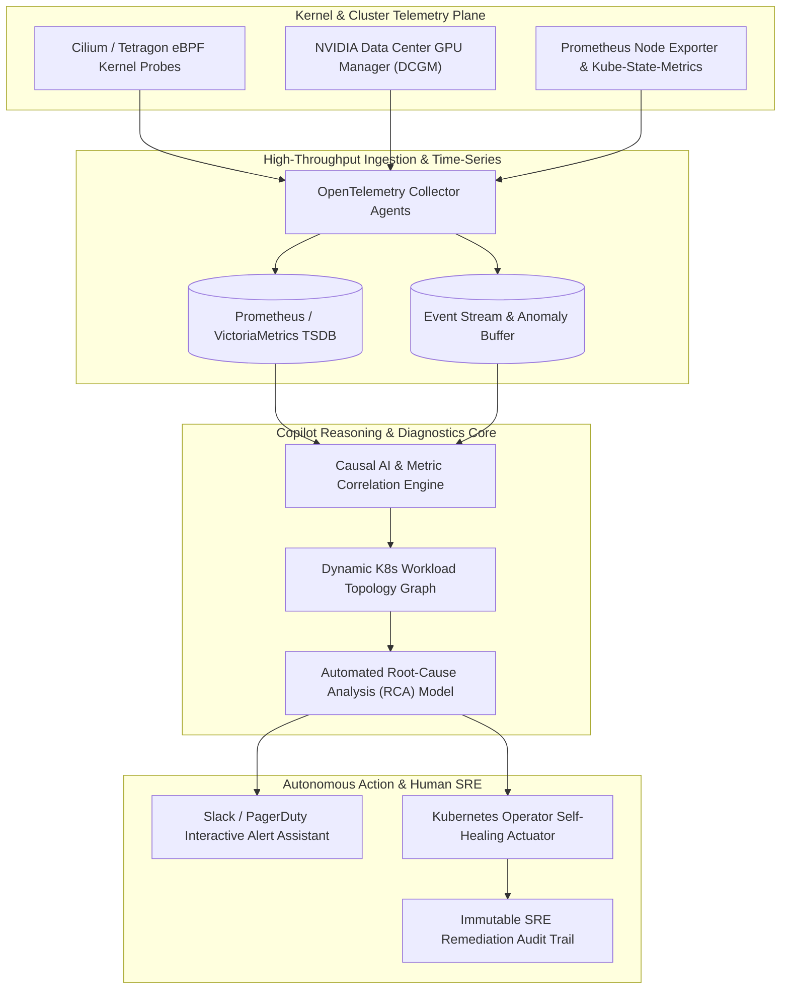

# AI Infrastructure Monitoring Copilot (`ai-infra-monitoring-copilot`)

[](https://pradeeptalari.me/projects/)
[](https://pradeeptalari.me/tools/repo-learning/)
[](https://pradeeptalari.me/projects/ai-infra-monitoring-copilot.html)
[](LICENSE)
[](SECURITY.md)
[](#-9-devsecops-governance-compliance-matrix)

Autonomous SRE copilot leveraging eBPF telemetry, Prometheus metrics, and causal AI to detect GPU saturation, network bottlenecks, and inference failures.

---

## 🏗️ Production Architecture Flow



---

## 🧠 Core Engineering & Architectural Principles

### 1. Zero-Overhead Kernel Telemetry via eBPF
Captures raw Linux kernel system calls, socket transitions, and network drops using eBPF probes without modifying application code or consuming precious compute overhead.

### 2. Deep Hardware Observability with NVIDIA DCGM
Directly polls NVLink bandwidth, Tensor Core duty cycles, FP8/FP16 arithmetic saturation, and VRAM thermal throttle metrics to isolate physical GPU performance degradation.

### 3. Causal AI Metric Correlation & Graph Topology
Constructs dynamic real-time dependency graphs linking Kubernetes pods, storage mounts, and network fabrics to differentiate root causes from cascading secondary alerts.

### 4. Autonomous Remediation with Safeguard Gates
Executes verified Kubernetes remediation actions (e.g. cordoning thermal-throttling GPU nodes, restarting zombie inference pods) with strict rate-limiting and human approval toggles.

### 5. Predictive Saturation Forecasting
Forecasts GPU memory exhaust and model serving latency degradation up to 15 minutes before thresholds are breached using autoregressive time-series analysis.

---

## 💻 Infrastructure & Software Technology Stack

| Architectural Layer | Technology & Tools | Production Role |
|---|---|---|
| **Kernel Telemetry** | eBPF, Cilium Tetragon, BCC | In-kernel socket and system call monitoring with zero userspace overhead |
| **GPU Monitoring** | NVIDIA DCGM Exporter, Prometheus | Real-time telemetry of VRAM allocation, PCIe bus utilization, and power draw |
| **Diagnostics Engine** | Python 3.11, NetworkX, Scikit-learn | Graph-based causal inference, anomaly scoring, and topology analysis |
| **Incident Workflow** | Slack Bolt API, PagerDuty Webhooks | Interactive conversational SRE copilot interface with drill-down actions |
| **Remediation Actuator** | Kubernetes Python Client, Argo Workflows | Automated pod evictions, node cordoning, and dynamic GPU memory flushing |

---

## 🎯 Where to Use (Real-World Production Scenarios)

1. **Distributed Model Training Run Diagnostics**:
   -  Automatically detecting NCCL ring all-reduce communication hangs across 64x H100 GPU clusters.
2. **Inference Cluster GPU Memory Leak Triage**:
   -  Identifying progressive VRAM fragmentation in vLLM pods and triggering graceful cache eviction before OOMs occur.
3. **Kubernetes Noisy Neighbor Elimination**:
   -  Pinpointing CPU and network bandwidth hogging containers on multi-tenant nodes and throttling resource quotas.
4. **Autonomous Night-Watch Incident Resolution**:
   -  Diagnosing non-critical infrastructure alerts overnight and generating detailed post-mortems for morning review.

---

## 🛠️ Step-by-Step SRE Deployment & Verification Runbook

### 1. Prerequisites
- Docker & Docker Compose (v2.20+)
- Python 3.10+ or Node.js 20+
- Git & GitHub CLI (`gh`)
- Valid cloud credentials (AWS / Azure / Kubernetes) if deploying live

### 2. Clone Repository
```bash
git clone https://github.com/Pradeeptalari14/ai-infra-monitoring-copilot.git
cd ai-infra-monitoring-copilot
```

### 3. Configure Safe Environment Template
```bash
cp .env.example .env
# Edit .env with your local or staging environment variables
```

### 4. Execute Automated Validation & Linting
```bash
bash scripts/validate.sh
```

### 5. Build & Launch Containerized Stack
```bash
docker compose up -d --build
# Verify health probe status
curl -s http://localhost:8000/health || echo "Service started"
```

---

## 🛡️ 9+ DevSecOps Governance Compliance Matrix

| Rule # | Requirement | Implementation in Repository | Status |
|---|---|---|---|
| **1** | **`README.md`** | Architecture DAG, core principles, technology stack, runbook, and compliance matrix | ✅ Complete |
| **2** | **`LICENSE`** | Permissive MIT Open Source License (Copyright © 2026 Talari Pradeep) | ✅ Verified |
| **3** | **`SECURITY.md`** | Vulnerability disclosure SLAs, supported versions, secret policies | ✅ Verified |
| **4** | **`.gitignore`** | Hardened against .env, __pycache__, credentials, build artifacts | ✅ Cleaned & Active |
| **5** | **`.env.example`** | Safe template with Prometheus URLs, Slack webhooks, and Kubernetes cluster configs | ✅ Provided |
| **6** | **`.pre-commit-config.yaml`** | Gitleaks secret scans, YAML/JSON linters, trailing whitespace checks | ✅ Configured |
| **7** | **`.github/workflows/`** | Automated CI validation pipeline (sre-validation.yml) & Dependabot updates | ✅ Enabled |
| **8** | **`docs/ Knowledge Suite`** | TROUBLESHOOTING.md, GLOSSARY.md, COMPLIANCE.md | ✅ Documented |
| **9** | **`scripts/validate.sh`** | Automated syntax, dependency, and health checking verification script | ✅ Executable |
| **10** | **`CHANGELOG.md`** | Structured release notes following Keep-a-Changelog standard | ✅ Maintained |

---

*Synchronized with [AI Infrastructure Monitoring Copilot](https://pradeeptalari.me/projects/ai-infra-monitoring-copilot.html) & [Architecture Center](https://pradeeptalari.me/architecture/) — [Talari Pradeep Portfolio](https://pradeeptalari.me)*
